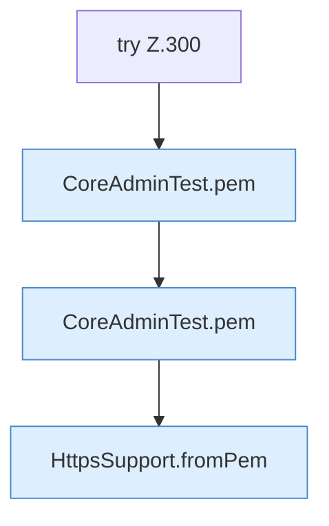

[[00 Start]] › [[Tests]] › [[CoreAdminTest]] › [[CoreAdminTest.Teil3]] › [[CoreAdminTest.selfSignedHandshakeAndPem]] › [[CoreAdminTest.selfSignedHandshakeAndPem.Teil3]]

# CoreAdminTest.selfSignedHandshakeAndPem.Teil3



```knoten
try Z.300
  Zeile 300: Versuch. Der Fehlerpfad geht in catch.
CoreAdminTest.pem
  Ein Schritt in einem [[Glossar#Probelauf|Probelauf]]. Er gehört nicht zum laufenden Server. `pem` in `CoreAdminTest.java`. Nur Test.
HttpsSupport.fromPem
  Dieser Teil macht hier einen einzelnen Schritt. Eine Ebene tiefer steht er genauer. `fromPem` in `HttpsSupport.java`. Ruft `loadKey`.
```

> [!knoten]- Was die Blöcke tun
> - **try Z.300**: Zeile 300: Versuch. Der Fehlerpfad geht in catch.
> - **CoreAdminTest.pem**: Ein Schritt in einem [[Glossar#Probelauf|Probelauf]]. Er gehört nicht zum laufenden Server. `pem` in `CoreAdminTest.java`. Nur Test.
> - **HttpsSupport.fromPem**: Dieser Teil macht hier einen einzelnen Schritt. Eine Ebene tiefer steht er genauer. `fromPem` in `HttpsSupport.java`. Ruft `loadKey`.

- Ein weiterer Abschnitt derselben Übersicht.
- Fortsetzung von `CoreAdminTest.selfSignedHandshakeAndPem`.
