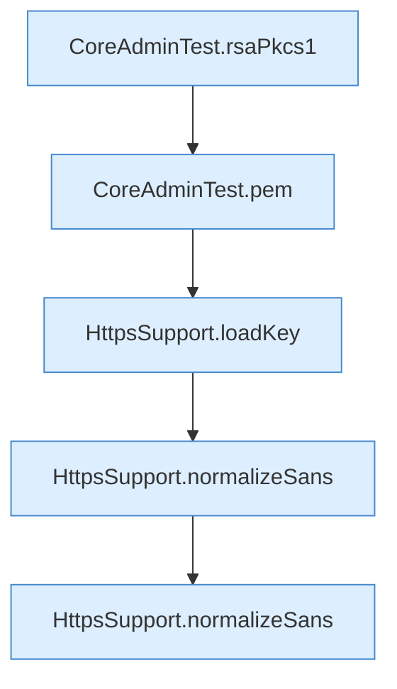

[[00 Start]] › [[Tests]] › [[CoreAdminTest]] › [[CoreAdminTest.Teil3]] › [[CoreAdminTest.selfSignedHandshakeAndPem]] › [[CoreAdminTest.selfSignedHandshakeAndPem.Teil4]]

# CoreAdminTest.selfSignedHandshakeAndPem.Teil4



```knoten
CoreAdminTest.rsaPkcs1
  Ein Schritt in einem [[Glossar#Probelauf|Probelauf]]. Er gehört nicht zum laufenden Server. `rsaPkcs1` in `CoreAdminTest.java`. Ruft `derValue`. Nur Test.
CoreAdminTest.pem
  Ein Schritt in einem [[Glossar#Probelauf|Probelauf]]. Er gehört nicht zum laufenden Server. `pem` in `CoreAdminTest.java`. Nur Test.
HttpsSupport.loadKey
  Dieser Teil lädt hier einen Schritt. Eine Ebene tiefer steht er genauer. Lädt `loadKey`. Ruft `pemBlock`, `wrapPkcs1`.
HttpsSupport.normalizeSans
  Dieser Teil macht hier einen einzelnen Schritt. Eine Ebene tiefer steht er genauer. Vereinheitlicht `normalizeSans`.
```

> [!knoten]- Was die Blöcke tun
> - **CoreAdminTest.rsaPkcs1**: Ein Schritt in einem [[Glossar#Probelauf|Probelauf]]. Er gehört nicht zum laufenden Server. `rsaPkcs1` in `CoreAdminTest.java`. Ruft `derValue`. Nur Test.
> - **CoreAdminTest.pem**: Ein Schritt in einem [[Glossar#Probelauf|Probelauf]]. Er gehört nicht zum laufenden Server. `pem` in `CoreAdminTest.java`. Nur Test.
> - **HttpsSupport.loadKey**: Dieser Teil lädt hier einen Schritt. Eine Ebene tiefer steht er genauer. Lädt `loadKey`. Ruft `pemBlock`, `wrapPkcs1`.
> - **HttpsSupport.normalizeSans**: Dieser Teil macht hier einen einzelnen Schritt. Eine Ebene tiefer steht er genauer. Vereinheitlicht `normalizeSans`.

- Ein weiterer Abschnitt derselben Übersicht.
- Fortsetzung von `CoreAdminTest.selfSignedHandshakeAndPem`.
