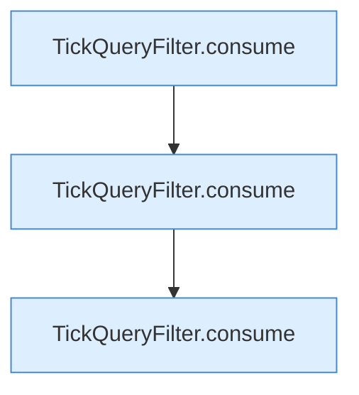

[[00 Start]] › [[Tests]] › [[CoreAdminTest]] › [[CoreAdminTest.Teil1]] › [[CoreAdminTest.tickQueryHidesOnlyTheReply]] › [[CoreAdminTest.tickQueryHidesOnlyTheReply.Teil1]]

# CoreAdminTest.tickQueryHidesOnlyTheReply.Teil1

- Fortsetzung von `CoreAdminTest.tickQueryHidesOnlyTheReply`, Quellreihenfolge.
