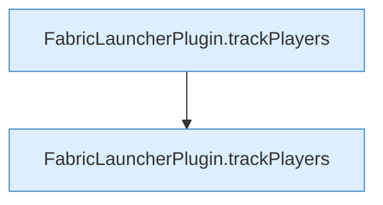

[[00 Start]] › [[Tests]] › [[CoreAdminTest]] › [[CoreAdminTest.Teil1]] › [[CoreAdminTest.tracksMinecraftPlayerEventsAndListResponses]] › [[CoreAdminTest.tracksMinecraftPlayerEventsAndListResponses.Teil2]]

# CoreAdminTest.tracksMinecraftPlayerEventsAndListResponses.Teil2



```knoten
FabricLauncherPlugin.trackPlayers
  Merkt sich, welche [[Glossar#Spieler|Spieler]] gerade auf dem [[Glossar#Spielserver|Spielserver]] sind. Führt mit `trackPlayers`.
```

> [!knoten]- Was die Blöcke tun
> - **FabricLauncherPlugin.trackPlayers**: Merkt sich, welche [[Glossar#Spieler|Spieler]] gerade auf dem [[Glossar#Spielserver|Spielserver]] sind. Führt mit `trackPlayers`.

- Ein weiterer Abschnitt derselben Übersicht.
- Fortsetzung von `CoreAdminTest.tracksMinecraftPlayerEventsAndListResponses`.
