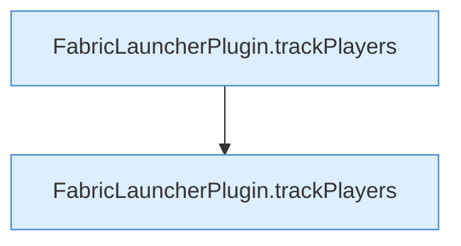

[[00 Start]] › [[Tests]] › [[CoreAdminTest]] › [[CoreAdminTest.Teil1]] › [[CoreAdminTest.tracksMinecraftPlayerEventsAndListResponses]] › [[CoreAdminTest.tracksMinecraftPlayerEventsAndListResponses.Teil2]]

# CoreAdminTest.tracksMinecraftPlayerEventsAndListResponses.Teil2

- Fortsetzung von `CoreAdminTest.tracksMinecraftPlayerEventsAndListResponses`, Quellreihenfolge.
