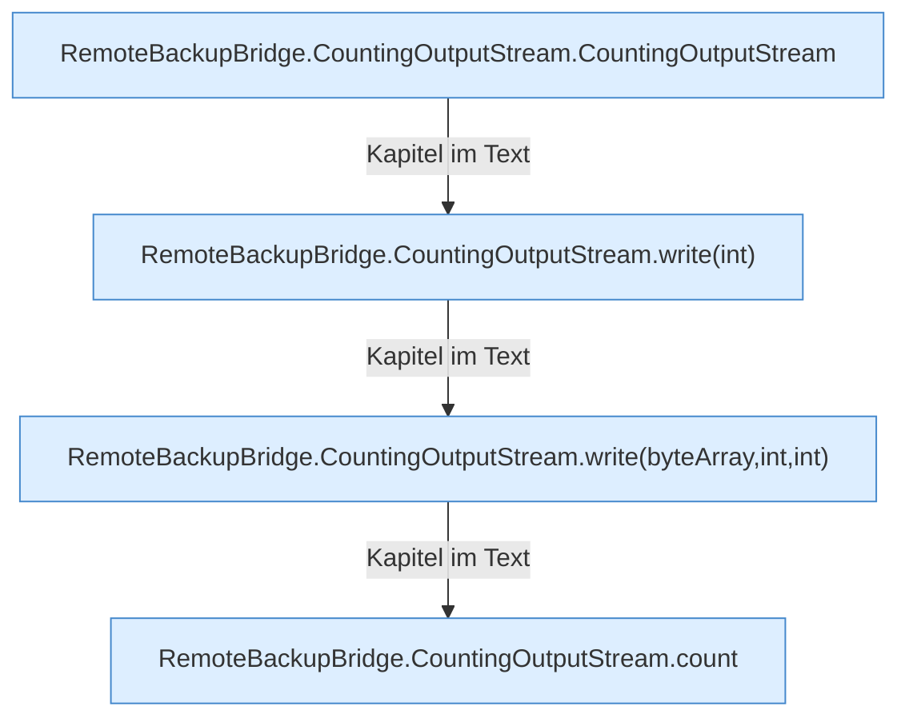

[[00 Start]] › [[Backup]] › [[Backup-Bruecken]] › [[RemoteBackupBridge]] › [[CountingOutputStream]]

# CountingOutputStream



```knoten
RemoteBackupBridge.CountingOutputStream.CountingOutputStream
  Die Sicherung über das Netz macht hier einen einzelnen Schritt. Eine Ebene tiefer steht er genauer. `CountingOutputStream` in `RemoteBackupBridge.java`.
RemoteBackupBridge.CountingOutputStream.write(int)
  Die Sicherung über das Netz schreibt das. Schreibt `write`.
RemoteBackupBridge.CountingOutputStream.write(byteArray,int,int)
  Die Sicherung über das Netz schreibt das. Schreibt `write`.
RemoteBackupBridge.CountingOutputStream.count
  Die Sicherung über das Netz zählt das. Zählt `count`.
```

> [!knoten]- Was die Blöcke tun
> - **RemoteBackupBridge.CountingOutputStream.CountingOutputStream**: Die Sicherung über das Netz macht hier einen einzelnen Schritt. Eine Ebene tiefer steht er genauer. `CountingOutputStream` in `RemoteBackupBridge.java`.
> - **RemoteBackupBridge.CountingOutputStream.write(int)**: Die Sicherung über das Netz schreibt das. Schreibt `write`.
> - **RemoteBackupBridge.CountingOutputStream.write(byteArray,int,int)**: Die Sicherung über das Netz schreibt das. Schreibt `write`.
> - **RemoteBackupBridge.CountingOutputStream.count**: Die Sicherung über das Netz zählt das. Zählt `count`.

- Zählt mit, wie viel gerade in die [[Glossar#Sicherungskopie|Sicherungskopie]] geschrieben wurde.
