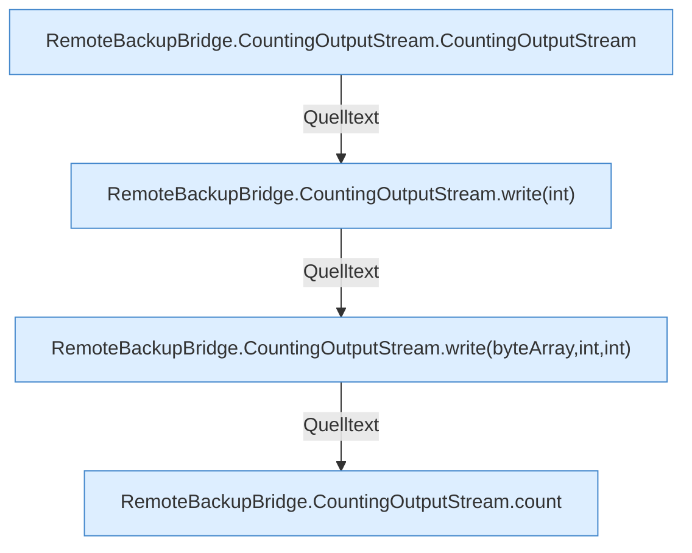

[[00 Start]] › [[Backup]] › [[Backup-Bruecken]] › [[RemoteBackupBridge]] › [[CountingOutputStream]]

# CountingOutputStream



```knoten
RemoteBackupBridge.CountingOutputStream.CountingOutputStream
  `CountingOutputStream` in `RemoteBackupBridge.java`.
RemoteBackupBridge.CountingOutputStream.write(int)
  Schreibt `write`.
RemoteBackupBridge.CountingOutputStream.write(byteArray,int,int)
  Schreibt `write`.
RemoteBackupBridge.CountingOutputStream.count
  Zählt `count`.
```


