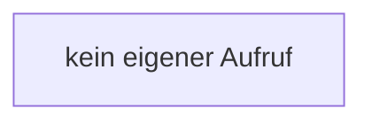

[[00 Start]] › [[Dashboard-HTTP]] › [[HTTP-Klassen]] › [[CrashIndex]] › [[CrashIndex.CrashIndex]]

# CrashIndex.CrashIndex

`CrashIndex.CrashIndex()` [src/main/java/de/aichele/childlauncher/CrashIndex.java:18–18](https://github.com/Sciddie/minecraft-serverhoster-plugin/blob/95b02b953b0b4c23673e900e021a7c3c844aa37d/src/main/java/de/aichele/childlauncher/CrashIndex.java#L18-L18)

- `CrashIndex` in `src/main/java/de/aichele/childlauncher/CrashIndex.java`
