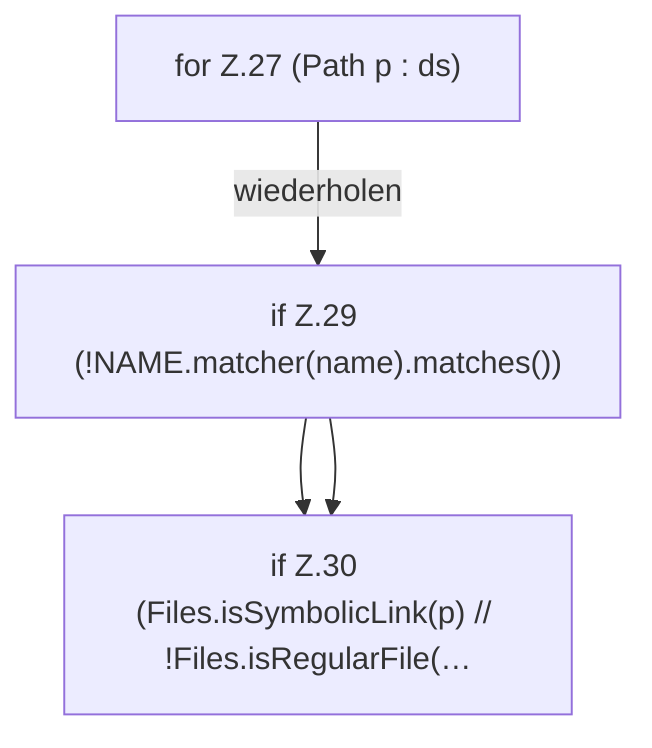

[[00 Start]] › [[Dashboard-HTTP]] › [[HTTP-Klassen]] › [[CrashIndex]] › [[CrashIndex.list]] › [[CrashIndex.list.Z26.Z27]]

# CrashIndex.list.Z26.Z27



```knoten
for Z.27 (Path p : ds)
  Zeile 27: Schleife `(Path p : ds)`.
if Z.29 (!NAME.matcher(name).matches())
  Zeile 29: prüft `(!NAME.matcher(name).matches())`.
if Z.30 (Files.isSymbolicLink(p) // !Files.isRegularFile(…
  Zeile 30: prüft `(Files.isSymbolicLink(p) // !Files.isRegularFile(…`.
```

- Fortsetzung von `CrashIndex.list.Z26`, Quellreihenfolge.
