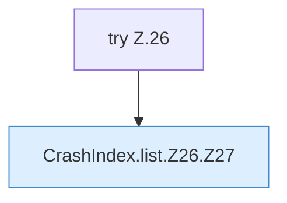

[[00 Start]] › [[Dashboard-HTTP]] › [[HTTP-Klassen]] › [[CrashIndex]] › [[CrashIndex.list]] › [[CrashIndex.list.Z26]]

# CrashIndex.list.Z26



```knoten
try Z.26
  Zeile 26: Versuch. Der Fehlerpfad geht in catch.
CrashIndex.list.Z26.Z27
  Der Ablauf geht in [[Glossar#Zeile|Zeile]] 27 weiter. Eine Ebene tiefer steht er genauer. Fortsetzung des Ablaufs ab Zeile 27.
```

> [!knoten]- Was die Blöcke tun
> - **try Z.26**: Zeile 26: Versuch. Der Fehlerpfad geht in catch.
> - **CrashIndex.list.Z26.Z27**: Der Ablauf geht in [[Glossar#Zeile|Zeile]] 27 weiter. Eine Ebene tiefer steht er genauer. Fortsetzung des Ablaufs ab Zeile 27.

- Der Ablauf geht in [[Glossar#Zeile|Zeile]] 26 weiter. Eine Ebene tiefer steht er genauer.
- Fortsetzung von `CrashIndex.list`.
