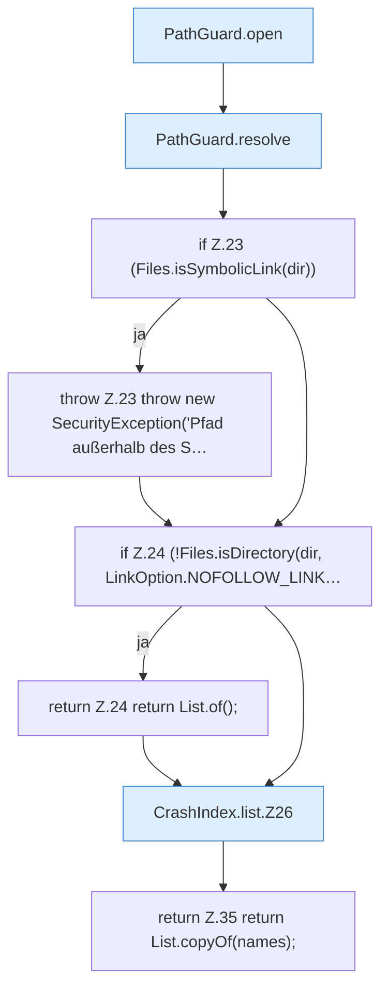

[[00 Start]] › [[Dashboard-HTTP]] › [[HTTP-Klassen]] › [[CrashIndex]] › [[CrashIndex.list]]

# CrashIndex.list

`CrashIndex.list(Path workDir)` [src/main/java/de/aichele/childlauncher/CrashIndex.java:20–36](https://github.com/Sciddie/minecraft-serverhoster-plugin/blob/95b02b953b0b4c23673e900e021a7c3c844aa37d/src/main/java/de/aichele/childlauncher/CrashIndex.java#L20-L36)



```knoten
PathGuard.open
  Dieser Teil öffnet das. Öffnet `open`. Ruft `PathGuard`.
PathGuard.resolve
  Dieser Teil bestimmt das. Löst auf `resolve`.
if Z.23 (Files.isSymbolicLink(dir))
  Zeile 23: prüft `(Files.isSymbolicLink(dir))`.
throw Z.23 throw new SecurityException('Pfad außerhalb des S…
  Zeile 23: Abbruch `throw new SecurityException('Pfad außerhalb des S…`.
if Z.24 (!Files.isDirectory(dir, LinkOption.NOFOLLOW_LINK…
  Zeile 24: prüft `(!Files.isDirectory(dir, LinkOption.NOFOLLOW_LINK…`.
return Z.24 return List.of();
  Zeile 24: Rückgabe `return List.of();`.
CrashIndex.list.Z26
  Der Ablauf geht in [[Glossar#Zeile|Zeile]] 26 weiter. Eine Ebene tiefer steht er genauer. Fortsetzung des Ablaufs ab Zeile 26.
return Z.35 return List.copyOf(names);
  Zeile 35: Rückgabe `return List.copyOf(names);`.
```

> [!knoten]- Was die Blöcke tun
> - **PathGuard.open**: Dieser Teil öffnet das. Öffnet `open`. Ruft `PathGuard`.
> - **PathGuard.resolve**: Dieser Teil bestimmt das. Löst auf `resolve`.
> - **if Z.23 (Files.isSymbolicLink(dir))**: Zeile 23: prüft `(Files.isSymbolicLink(dir))`.
> - **throw Z.23 throw new SecurityException('Pfad außerhalb des S…**: Zeile 23: Abbruch `throw new SecurityException('Pfad außerhalb des S…`.
> - **if Z.24 (!Files.isDirectory(dir, LinkOption.NOFOLLOW_LINK…**: Zeile 24: prüft `(!Files.isDirectory(dir, LinkOption.NOFOLLOW_LINK…`.
> - **return Z.24 return List.of();**: Zeile 24: Rückgabe `return List.of();`.
> - **CrashIndex.list.Z26**: Der Ablauf geht in [[Glossar#Zeile|Zeile]] 26 weiter. Eine Ebene tiefer steht er genauer. Fortsetzung des Ablaufs ab Zeile 26.
> - **return Z.35 return List.copyOf(names);**: Zeile 35: Rückgabe `return List.copyOf(names);`.

- Dieser Teil zeigt das.
- `list` in `src/main/java/de/aichele/childlauncher/CrashIndex.java`
