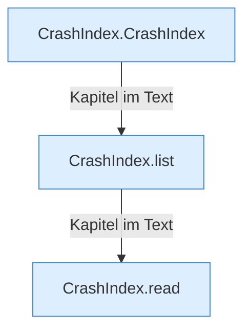

[[00 Start]] › [[Dashboard-HTTP]] › [[HTTP-Klassen]] › [[CrashIndex]]

# CrashIndex



```knoten
CrashIndex.CrashIndex
  Dieser Teil kümmert sich um die Position. Im [[Glossar#Quelltext|Quelltext]] heißt das `CrashIndex`.
CrashIndex.list
  Dieser Teil zeigt das. Im [[Glossar#Quelltext|Quelltext]] heißt das `list`.
CrashIndex.read
  Dieser Teil liest das. Im [[Glossar#Quelltext|Quelltext]] heißt das `read`.
```

> [!knoten]- Was die Blöcke tun
> - **CrashIndex.CrashIndex**: Dieser Teil kümmert sich um die Position. Im [[Glossar#Quelltext|Quelltext]] heißt das `CrashIndex`.
> - **CrashIndex.list**: Dieser Teil zeigt das. Im [[Glossar#Quelltext|Quelltext]] heißt das `list`.
> - **CrashIndex.read**: Dieser Teil liest das. Im [[Glossar#Quelltext|Quelltext]] heißt das `read`.

- Sucht [[Glossar#Absturzbericht|Absturzberichte]] und liefert ihren Text.
