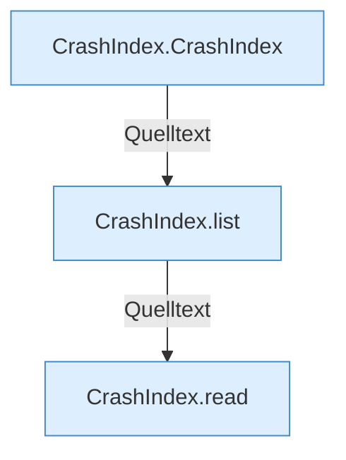

[[00 Start]] › [[Dashboard-HTTP]] › [[HTTP-Klassen]] › [[CrashIndex]]

# CrashIndex



```knoten
CrashIndex.CrashIndex
  Betrifft Crash-Reports `CrashIndex`.
CrashIndex.list
  Listet `list`. Ruft `open`, `resolve`.
CrashIndex.read
  Liest `read`. Ruft `open`, `resolve`, `query`.
```


