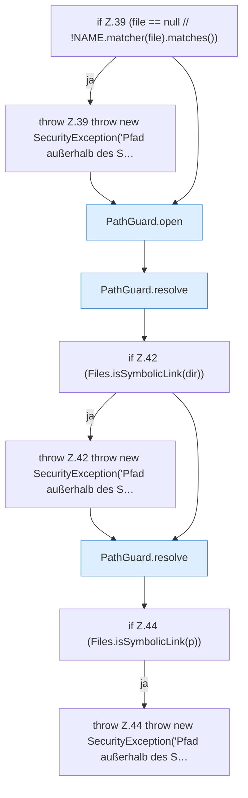

[[00 Start]] › [[Dashboard-HTTP]] › [[HTTP-Klassen]] › [[CrashIndex]] › [[CrashIndex.read]] › [[CrashIndex.read.Teil1]]

# CrashIndex.read.Teil1



```knoten
if Z.39 (file == null // !NAME.matcher(file).matches())
  Zeile 39: prüft `(file == null // !NAME.matcher(file).matches())`.
throw Z.39 throw new SecurityException('Pfad außerhalb des S…
  Zeile 39: Abbruch `throw new SecurityException('Pfad außerhalb des S…`.
PathGuard.open
  Dieser Teil öffnet das. Öffnet `open`. Ruft `PathGuard`.
PathGuard.resolve
  Dieser Teil bestimmt das. Löst auf `resolve`.
if Z.42 (Files.isSymbolicLink(dir))
  Zeile 42: prüft `(Files.isSymbolicLink(dir))`.
throw Z.42 throw new SecurityException('Pfad außerhalb des S…
  Zeile 42: Abbruch `throw new SecurityException('Pfad außerhalb des S…`.
if Z.44 (Files.isSymbolicLink(p))
  Zeile 44: prüft `(Files.isSymbolicLink(p))`.
throw Z.44 throw new SecurityException('Pfad außerhalb des S…
  Zeile 44: Abbruch `throw new SecurityException('Pfad außerhalb des S…`.
```

> [!knoten]- Was die Blöcke tun
> - **if Z.39 (file == null // !NAME.matcher(file).matches())**: Zeile 39: prüft `(file == null // !NAME.matcher(file).matches())`.
> - **throw Z.39 throw new SecurityException('Pfad außerhalb des S…**: Zeile 39: Abbruch `throw new SecurityException('Pfad außerhalb des S…`.
> - **PathGuard.open**: Dieser Teil öffnet das. Öffnet `open`. Ruft `PathGuard`.
> - **PathGuard.resolve**: Dieser Teil bestimmt das. Löst auf `resolve`.
> - **if Z.42 (Files.isSymbolicLink(dir))**: Zeile 42: prüft `(Files.isSymbolicLink(dir))`.
> - **throw Z.42 throw new SecurityException('Pfad außerhalb des S…**: Zeile 42: Abbruch `throw new SecurityException('Pfad außerhalb des S…`.
> - **if Z.44 (Files.isSymbolicLink(p))**: Zeile 44: prüft `(Files.isSymbolicLink(p))`.
> - **throw Z.44 throw new SecurityException('Pfad außerhalb des S…**: Zeile 44: Abbruch `throw new SecurityException('Pfad außerhalb des S…`.

- Ein weiterer Abschnitt derselben Übersicht.
- Fortsetzung von `CrashIndex.read`.
