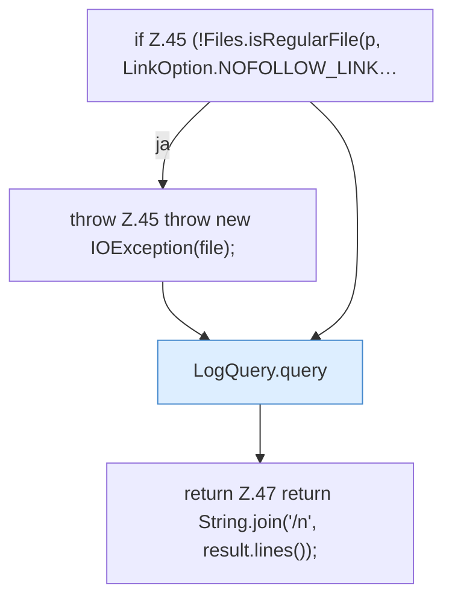

[[00 Start]] › [[Dashboard-HTTP]] › [[HTTP-Klassen]] › [[CrashIndex]] › [[CrashIndex.read]] › [[CrashIndex.read.Teil2]]

# CrashIndex.read.Teil2



```knoten
if Z.45 (!Files.isRegularFile(p, LinkOption.NOFOLLOW_LINK…
  Zeile 45: prüft `(!Files.isRegularFile(p, LinkOption.NOFOLLOW_LINK…`.
throw Z.45 throw new IOException(file);
  Zeile 45: Abbruch `throw new IOException(file);`.
LogQuery.query
  Fragt ab `query`. Ruft `levelOk`.
return Z.47 return String.join('/n', result.lines());
  Zeile 47: Rückgabe `return String.join('/n', result.lines());`.
```

- Fortsetzung von `CrashIndex.read`, Quellreihenfolge.
