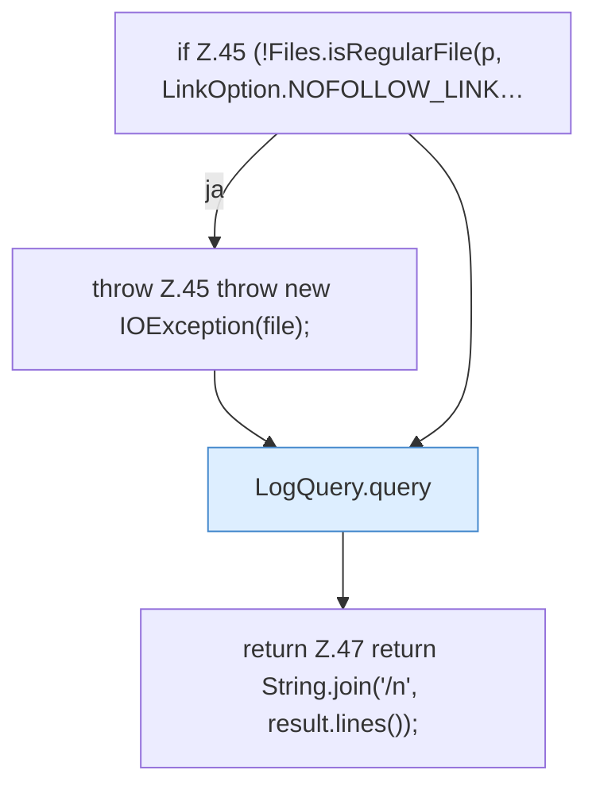

[[00 Start]] › [[Dashboard-HTTP]] › [[HTTP-Klassen]] › [[CrashIndex]] › [[CrashIndex.read]] › [[CrashIndex.read.Teil2]]

# CrashIndex.read.Teil2

- Fortsetzung von `CrashIndex.read`, Quellreihenfolge.
