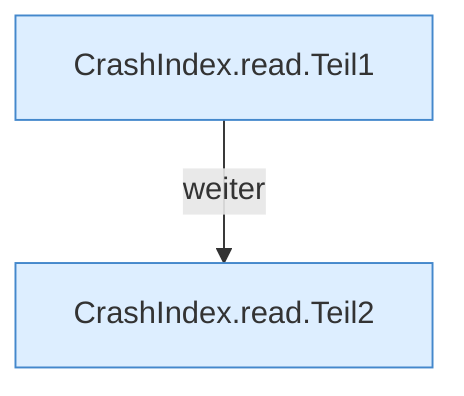

[[00 Start]] › [[Dashboard-HTTP]] › [[HTTP-Klassen]] › [[CrashIndex]] › [[CrashIndex.read]]

# CrashIndex.read

`CrashIndex.read(Path workDir, String file)` [src/main/java/de/aichele/childlauncher/CrashIndex.java:38–48](https://github.com/Sciddie/minecraft-serverhoster-plugin/blob/95b02b953b0b4c23673e900e021a7c3c844aa37d/src/main/java/de/aichele/childlauncher/CrashIndex.java#L38-L48)

- `read` in `src/main/java/de/aichele/childlauncher/CrashIndex.java`
