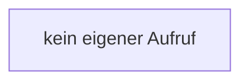

[[00 Start]] › [[Zeitplaene]] › [[Plan-Klassen]] › [[CronExpr]] › [[CronExpr.CronExpr]]

# CronExpr.CronExpr

`CronExpr.CronExpr()` [src/main/java/de/aichele/childlauncher/CronExpr.java:9–9](https://github.com/Sciddie/minecraft-serverhoster-plugin/blob/95b02b953b0b4c23673e900e021a7c3c844aa37d/src/main/java/de/aichele/childlauncher/CronExpr.java#L9-L9)



```knoten
kein eigener Aufruf
  In diesem Stück gibt es keinen weiteren eigenen Aufruf.
```

> [!knoten]- Was die Blöcke tun
> - **kein eigener Aufruf**: In diesem Stück gibt es keinen weiteren eigenen Aufruf.

- Dieser Teil macht hier einen einzelnen Schritt. Eine Ebene tiefer steht er genauer.
- `CronExpr` in `src/main/java/de/aichele/childlauncher/CronExpr.java`
