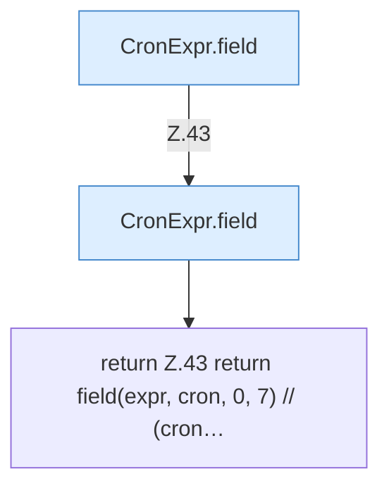

[[00 Start]] › [[Zeitplaene]] › [[Plan-Klassen]] › [[CronExpr]] › [[CronExpr.dow]]

# CronExpr.dow

`CronExpr.dow(String expr, DayOfWeek day)` [src/main/java/de/aichele/childlauncher/CronExpr.java:41–44](https://github.com/Sciddie/minecraft-serverhoster-plugin/blob/95b02b953b0b4c23673e900e021a7c3c844aa37d/src/main/java/de/aichele/childlauncher/CronExpr.java#L41-L44)

- `dow` in `src/main/java/de/aichele/childlauncher/CronExpr.java`
