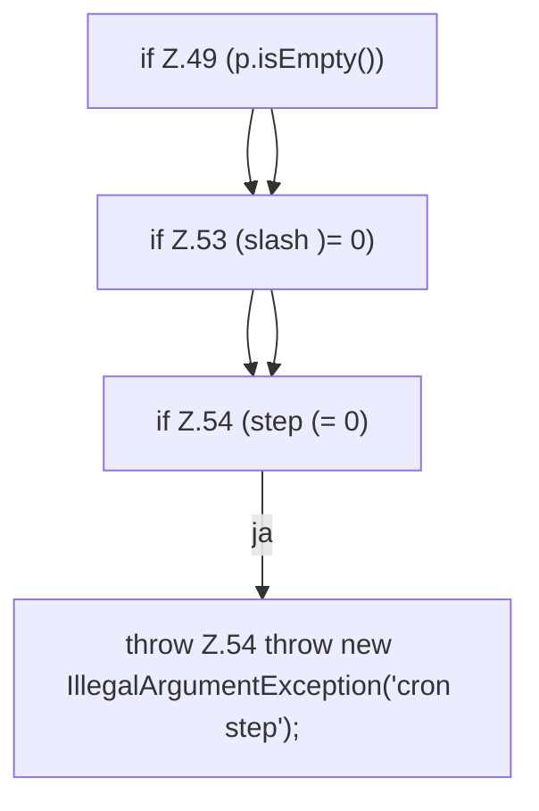

[[00 Start]] › [[Zeitplaene]] › [[Plan-Klassen]] › [[CronExpr]] › [[CronExpr.field]] › [[CronExpr.field.Z47.Teil1]]

# CronExpr.field.Z47.Teil1



```knoten
if Z.49 (p.isEmpty())
  Zeile 49: prüft `(p.isEmpty())`.
if Z.53 (slash )= 0)
  Zeile 53: prüft `(slash )= 0)`.
if Z.54 (step (= 0)
  Zeile 54: prüft `(step (= 0)`.
throw Z.54 throw new IllegalArgumentException('cron step');
  Zeile 54: Abbruch `throw new IllegalArgumentException('cron step');`.
```

> [!knoten]- Was die Blöcke tun
> - **if Z.49 (p.isEmpty())**: Zeile 49: prüft `(p.isEmpty())`.
> - **if Z.53 (slash )= 0)**: Zeile 53: prüft `(slash )= 0)`.
> - **if Z.54 (step (= 0)**: Zeile 54: prüft `(step (= 0)`.
> - **throw Z.54 throw new IllegalArgumentException('cron step');**: Zeile 54: Abbruch `throw new IllegalArgumentException('cron step');`.

- Ein weiterer Abschnitt derselben Übersicht.
- Fortsetzung von `CronExpr.field.Z47`.
