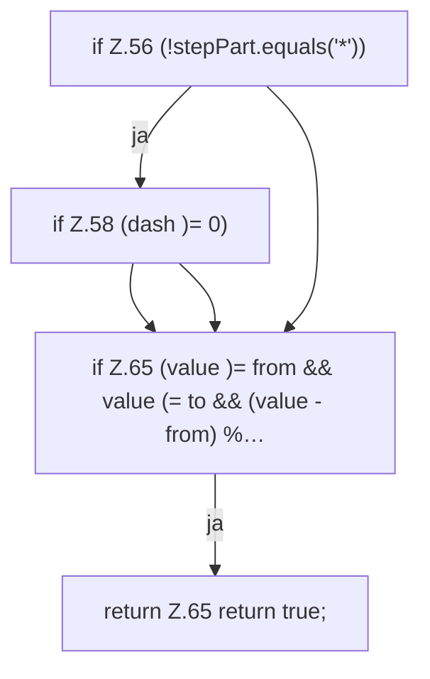

[[00 Start]] › [[Zeitplaene]] › [[Plan-Klassen]] › [[CronExpr]] › [[CronExpr.field]] › [[CronExpr.field.Z47.Teil2]]

# CronExpr.field.Z47.Teil2

- Fortsetzung von `CronExpr.field.Z47`, Quellreihenfolge.
