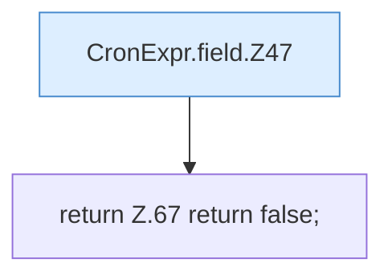

[[00 Start]] › [[Zeitplaene]] › [[Plan-Klassen]] › [[CronExpr]] › [[CronExpr.field]]

# CronExpr.field

`CronExpr.field(String expr, int value, int min, int max)` [src/main/java/de/aichele/childlauncher/CronExpr.java:46–68](https://github.com/Sciddie/minecraft-serverhoster-plugin/blob/95b02b953b0b4c23673e900e021a7c3c844aa37d/src/main/java/de/aichele/childlauncher/CronExpr.java#L46-L68)



```knoten
CronExpr.field.Z47
  Fortsetzung des Ablaufs ab Zeile 47.
return Z.67 return false;
  Zeile 67: Rückgabe `return false;`.
```

- `field` in `src/main/java/de/aichele/childlauncher/CronExpr.java`
