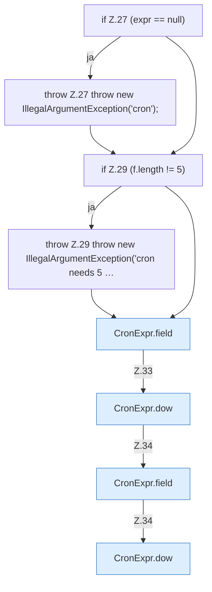

[[00 Start]] › [[Zeitplaene]] › [[Plan-Klassen]] › [[CronExpr]] › [[CronExpr.matches]] › [[CronExpr.matches.Teil1]]

# CronExpr.matches.Teil1



```knoten
if Z.27 (expr == null)
  Zeile 27: prüft `(expr == null)`.
throw Z.27 throw new IllegalArgumentException('cron');
  Zeile 27: Abbruch `throw new IllegalArgumentException('cron');`.
if Z.29 (f.length != 5)
  Zeile 29: prüft `(f.length != 5)`.
throw Z.29 throw new IllegalArgumentException('cron needs 5 …
  Zeile 29: Abbruch `throw new IllegalArgumentException('cron needs 5 …`.
CronExpr.field
  `field` in `CronExpr.java`.
CronExpr.dow
  `dow` in `CronExpr.java`. Ruft `field`.
```

- Fortsetzung von `CronExpr.matches`, Quellreihenfolge.
