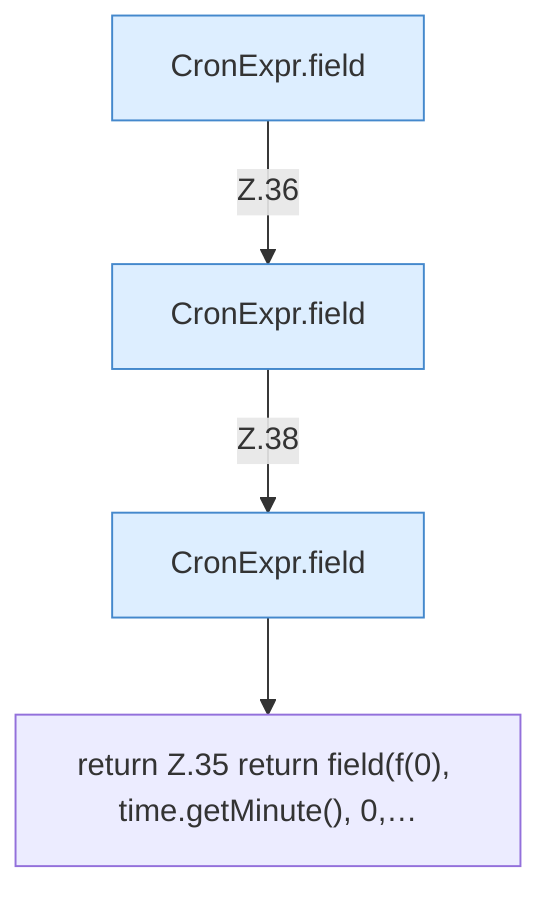

[[00 Start]] › [[Zeitplaene]] › [[Plan-Klassen]] › [[CronExpr]] › [[CronExpr.matches]] › [[CronExpr.matches.Teil2]]

# CronExpr.matches.Teil2



```knoten
CronExpr.field
  Dieser Teil macht hier einen einzelnen Schritt. Eine Ebene tiefer steht er genauer. `field` in `CronExpr.java`.
return Z.35 return field(f(0), time.getMinute(), 0,…
  Zeile 35: Rückgabe `return field(f(0), time.getMinute(), 0,…`.
```

> [!knoten]- Was die Blöcke tun
> - **CronExpr.field**: Dieser Teil macht hier einen einzelnen Schritt. Eine Ebene tiefer steht er genauer. `field` in `CronExpr.java`.
> - **return Z.35 return field(f(0), time.getMinute(), 0,…**: Zeile 35: Rückgabe `return field(f(0), time.getMinute(), 0,…`.

- Ein weiterer Abschnitt derselben Übersicht.
- Fortsetzung von `CronExpr.matches`.
