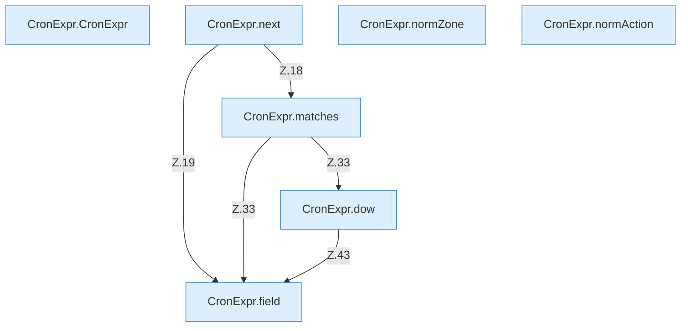

[[00 Start]] › [[Zeitplaene]] › [[Plan-Klassen]] › [[CronExpr]]

# CronExpr



```knoten
CronExpr.CronExpr
  Dieser Teil macht hier einen einzelnen Schritt. Eine Ebene tiefer steht er genauer. Im [[Glossar#Quelltext|Quelltext]] heißt das `CronExpr`.
CronExpr.next
  Dieser Teil geht weiter bei das. Im [[Glossar#Quelltext|Quelltext]] heißt das `next`.
CronExpr.matches
  Dieser Teil macht hier einen einzelnen Schritt. Eine Ebene tiefer steht er genauer. Im [[Glossar#Quelltext|Quelltext]] heißt das `matches`.
CronExpr.dow
  Dieser Teil macht hier einen einzelnen Schritt. Eine Ebene tiefer steht er genauer. Im [[Glossar#Quelltext|Quelltext]] heißt das `dow`.
CronExpr.field
  Dieser Teil macht hier einen einzelnen Schritt. Eine Ebene tiefer steht er genauer. Im [[Glossar#Quelltext|Quelltext]] heißt das `field`.
CronExpr.normZone
  Dieser Teil macht hier einen einzelnen Schritt. Eine Ebene tiefer steht er genauer. Im [[Glossar#Quelltext|Quelltext]] heißt das `normZone`.
CronExpr.normAction
  Dieser Teil kümmert sich um die Tätigkeit. Im [[Glossar#Quelltext|Quelltext]] heißt das `normAction`.
```

> [!knoten]- Was die Blöcke tun
> - **CronExpr.CronExpr**: Dieser Teil macht hier einen einzelnen Schritt. Eine Ebene tiefer steht er genauer. Im [[Glossar#Quelltext|Quelltext]] heißt das `CronExpr`.
> - **CronExpr.next**: Dieser Teil geht weiter bei das. Im [[Glossar#Quelltext|Quelltext]] heißt das `next`.
> - **CronExpr.matches**: Dieser Teil macht hier einen einzelnen Schritt. Eine Ebene tiefer steht er genauer. Im [[Glossar#Quelltext|Quelltext]] heißt das `matches`.
> - **CronExpr.dow**: Dieser Teil macht hier einen einzelnen Schritt. Eine Ebene tiefer steht er genauer. Im [[Glossar#Quelltext|Quelltext]] heißt das `dow`.
> - **CronExpr.field**: Dieser Teil macht hier einen einzelnen Schritt. Eine Ebene tiefer steht er genauer. Im [[Glossar#Quelltext|Quelltext]] heißt das `field`.
> - **CronExpr.normZone**: Dieser Teil macht hier einen einzelnen Schritt. Eine Ebene tiefer steht er genauer. Im [[Glossar#Quelltext|Quelltext]] heißt das `normZone`.
> - **CronExpr.normAction**: Dieser Teil kümmert sich um die Tätigkeit. Im [[Glossar#Quelltext|Quelltext]] heißt das `normAction`.

- Liest die Uhrzeitregel und sagt, ob der Zeitpunkt jetzt gekommen ist.
