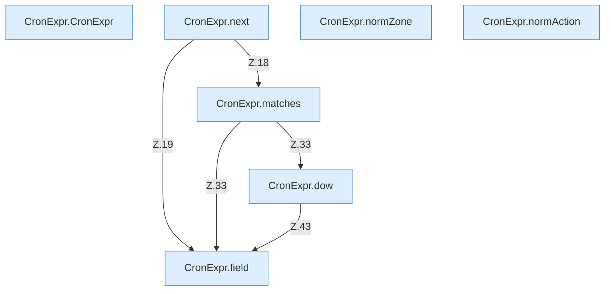

[[00 Start]] › [[Zeitplaene]] › [[Plan-Klassen]] › [[CronExpr]]

# CronExpr



```knoten
CronExpr.CronExpr
  `CronExpr` in `CronExpr.java`.
CronExpr.next
  Geht zum nächsten Schritt `next`. Ruft `matches`, `field`.
CronExpr.matches
  `matches` in `CronExpr.java`. Ruft `field`, `dow`.
CronExpr.dow
  `dow` in `CronExpr.java`. Ruft `field`.
CronExpr.field
  `field` in `CronExpr.java`.
CronExpr.normZone
  `normZone` in `CronExpr.java`.
CronExpr.normAction
  `normAction` in `CronExpr.java`.
```


