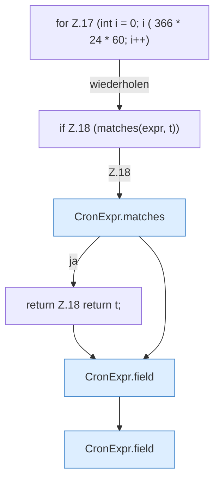

[[00 Start]] › [[Zeitplaene]] › [[Plan-Klassen]] › [[CronExpr]] › [[CronExpr.next]] › [[CronExpr.next.Z17]]

# CronExpr.next.Z17



```knoten
for Z.17 (int i = 0; i ( 366 * 24 * 60; i++)
  Zeile 17: Schleife `(int i = 0; i ( 366 * 24 * 60; i++)`.
if Z.18 (matches(expr, t))
  Zeile 18: prüft `(matches(expr, t))`.
CronExpr.matches
  `matches` in `CronExpr.java`. Ruft `field`, `dow`.
return Z.18 return t;
  Zeile 18: Rückgabe `return t;`.
CronExpr.field
  `field` in `CronExpr.java`.
```

- Fortsetzung von `CronExpr.next`, Quellreihenfolge.
