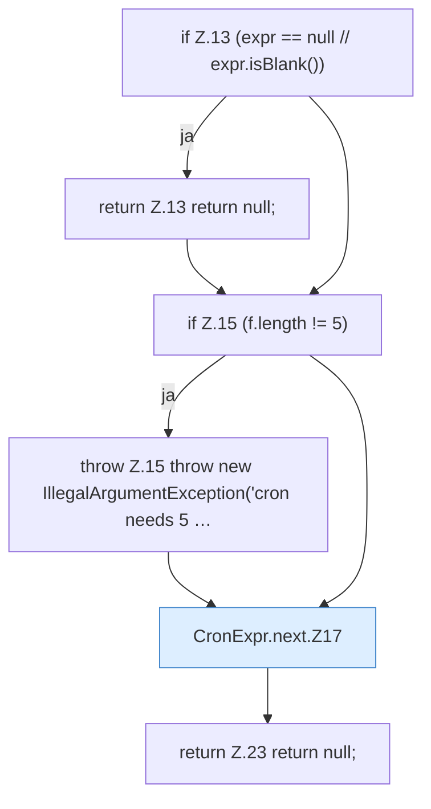

[[00 Start]] › [[Zeitplaene]] › [[Plan-Klassen]] › [[CronExpr]] › [[CronExpr.next]]

# CronExpr.next

`CronExpr.next(String expr, ZonedDateTime from)` [src/main/java/de/aichele/childlauncher/CronExpr.java:12–24](https://github.com/Sciddie/minecraft-serverhoster-plugin/blob/95b02b953b0b4c23673e900e021a7c3c844aa37d/src/main/java/de/aichele/childlauncher/CronExpr.java#L12-L24)



```knoten
if Z.13 (expr == null // expr.isBlank())
  Zeile 13: prüft `(expr == null // expr.isBlank())`.
return Z.13 return null;
  Zeile 13: Rückgabe `return null;`.
if Z.15 (f.length != 5)
  Zeile 15: prüft `(f.length != 5)`.
throw Z.15 throw new IllegalArgumentException('cron needs 5 …
  Zeile 15: Abbruch `throw new IllegalArgumentException('cron needs 5 …`.
CronExpr.next.Z17
  Fortsetzung des Ablaufs ab Zeile 17.
return Z.23 return null;
  Zeile 23: Rückgabe `return null;`.
```

- `next` in `src/main/java/de/aichele/childlauncher/CronExpr.java`
