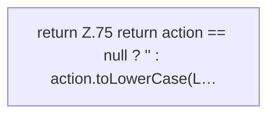

[[00 Start]] › [[Zeitplaene]] › [[Plan-Klassen]] › [[CronExpr]] › [[CronExpr.normAction]]

# CronExpr.normAction

`CronExpr.normAction(String action)` [src/main/java/de/aichele/childlauncher/CronExpr.java:74–76](https://github.com/Sciddie/minecraft-serverhoster-plugin/blob/95b02b953b0b4c23673e900e021a7c3c844aa37d/src/main/java/de/aichele/childlauncher/CronExpr.java#L74-L76)



```knoten
return Z.75 return action == null ? '' : action.toLowerCase(L…
  Zeile 75: Rückgabe `return action == null ? '' : action.toLowerCase(L…`.
```

> [!knoten]- Was die Blöcke tun
> - **return Z.75 return action == null ? '' : action.toLowerCase(L…**: Zeile 75: Rückgabe `return action == null ? '' : action.toLowerCase(L…`.

- Dieser Teil kümmert sich um die Tätigkeit.
- `normAction` in `src/main/java/de/aichele/childlauncher/CronExpr.java`
