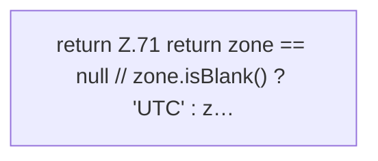

[[00 Start]] › [[Zeitplaene]] › [[Plan-Klassen]] › [[CronExpr]] › [[CronExpr.normZone]]

# CronExpr.normZone

`CronExpr.normZone(String zone)` [src/main/java/de/aichele/childlauncher/CronExpr.java:70–72](https://github.com/Sciddie/minecraft-serverhoster-plugin/blob/95b02b953b0b4c23673e900e021a7c3c844aa37d/src/main/java/de/aichele/childlauncher/CronExpr.java#L70-L72)



```knoten
return Z.71 return zone == null // zone.isBlank() ? 'UTC' : z…
  Zeile 71: Rückgabe `return zone == null // zone.isBlank() ? 'UTC' : z…`.
```

> [!knoten]- Was die Blöcke tun
> - **return Z.71 return zone == null // zone.isBlank() ? 'UTC' : z…**: Zeile 71: Rückgabe `return zone == null // zone.isBlank() ? 'UTC' : z…`.

- Dieser Teil macht hier einen einzelnen Schritt. Eine Ebene tiefer steht er genauer.
- `normZone` in `src/main/java/de/aichele/childlauncher/CronExpr.java`
