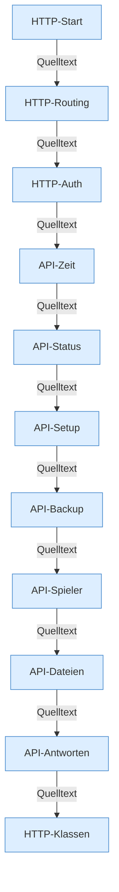

[[00 Start]] › [[Dashboard-HTTP]]

# Dashboard-HTTP



```knoten
HTTP-Start
  Startet den HTTP-Server, Port, TLS und den Pool ServerhosterPlugin-Web.
HTTP-Routing
  Verzweigt Methode und Pfad auf den passenden Handler.
HTTP-Auth
  Login, Cookie und Sitzung. SESSION_TTL ist 12 Stunden.
API-Zeit
  Tasks und Zeitpläne über HTTP.
API-Status
  Status, Konsole und Diagnose für das Dashboard.
API-Setup
  Einrichtung und Import über HTTP.
API-Backup
  Backup starten, herunterladen, löschen, Ziel prüfen.
API-Spieler
  Spielerliste und Spielerbefehle.
API-Dateien
  Verzeichnis lesen, Datei schreiben, umbenennen, löschen.
API-Antworten
  JSON, Text, Statuscode und Fehlerantwort.
HTTP-Klassen
  Passwort, TLS, Logfilter und Crash-Index.
```

- `HttpServer`-Kontext `/` zeigt auf `Dashboard.handle`.
