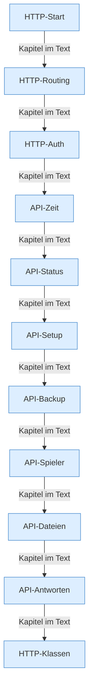

[[00 Start]] › [[Dashboard-HTTP]]

# Dashboard-HTTP



```knoten
HTTP-Start
  Öffnet diese Tür: Türnummer, [[Glossar#Verschlüsselung|Verschlüsselung]] und ein eigener [[Glossar#Thread|Thread]] für die Anfragen.
HTTP-Routing
  Sieht nach, welche Adresse der Browser aufgerufen hat, und gibt den Auftrag an den passenden Teil weiter.
HTTP-Auth
  [[Glossar#Anmeldung|Anmeldung]] an der [[Glossar#Bedienseite|Bedienseite]]. Das Passwort wird geprüft, danach gilt die Anmeldung zwölf Stunden.
API-Zeit
  Liefert und ändert Zeitpläne und die ältere Aufgabenliste.
API-Status
  Liefert der [[Glossar#Bedienseite|Bedienseite]] den Zustand, die [[Glossar#Konsole|Konsole]] und die [[Glossar#Diagnose|Diagnose]].
API-Setup
  Die [[Glossar#Einrichtung|Einrichtung]] über die [[Glossar#Bedienseite|Bedienseite]], inklusive Übernehmen einer älteren Anlage.
API-Backup
  Startet eine [[Glossar#Sicherungskopie|Sicherungskopie]], lädt sie herunter, löscht sie oder prüft das Ziel.
API-Spieler
  Liefert die [[Glossar#Spieler|Spieler]] und schickt einen [[Glossar#Befehl|Befehl]] zu einem Spieler.
API-Dateien
  Ordner ansehen, Datei lesen, schreiben, umbenennen oder löschen.
API-Antworten
  Wie eine Antwort an den Browser aussieht: Text, Zahlen oder eine Fehlermeldung.
HTTP-Klassen
  Die Helfer daneben: Passwort, [[Glossar#Verschlüsselung|Verschlüsselung]], Protokoll und [[Glossar#Absturzbericht|Absturzberichte]].
```

> [!knoten] Was die Blöcke tun
> - **HTTP-Start**: Öffnet diese Tür: Türnummer, [[Glossar#Verschlüsselung|Verschlüsselung]] und ein eigener [[Glossar#Thread|Thread]] für die Anfragen.
> - **HTTP-Routing**: Sieht nach, welche Adresse der Browser aufgerufen hat, und gibt den Auftrag an den passenden Teil weiter.
> - **HTTP-Auth**: [[Glossar#Anmeldung|Anmeldung]] an der [[Glossar#Bedienseite|Bedienseite]]. Das Passwort wird geprüft, danach gilt die Anmeldung zwölf Stunden.
> - **API-Zeit**: Liefert und ändert Zeitpläne und die ältere Aufgabenliste.
> - **API-Status**: Liefert der [[Glossar#Bedienseite|Bedienseite]] den Zustand, die [[Glossar#Konsole|Konsole]] und die [[Glossar#Diagnose|Diagnose]].
> - **API-Setup**: Die [[Glossar#Einrichtung|Einrichtung]] über die [[Glossar#Bedienseite|Bedienseite]], inklusive Übernehmen einer älteren Anlage.
> - **API-Backup**: Startet eine [[Glossar#Sicherungskopie|Sicherungskopie]], lädt sie herunter, löscht sie oder prüft das Ziel.
> - **API-Spieler**: Liefert die [[Glossar#Spieler|Spieler]] und schickt einen [[Glossar#Befehl|Befehl]] zu einem Spieler.
> - **API-Dateien**: Ordner ansehen, Datei lesen, schreiben, umbenennen oder löschen.
> - **API-Antworten**: Wie eine Antwort an den Browser aussieht: Text, Zahlen oder eine Fehlermeldung.
> - **HTTP-Klassen**: Die Helfer daneben: Passwort, [[Glossar#Verschlüsselung|Verschlüsselung]], Protokoll und [[Glossar#Absturzbericht|Absturzberichte]].

- Die Tür, über die der Browser mit dem [[Glossar#Plugin|Plugin]] spricht. Sie liefert die [[Glossar#Bedienseite|Bedienseite]] aus und nimmt Aufträge an.
