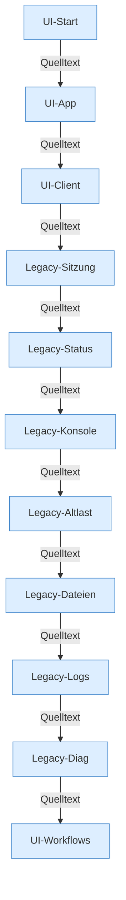

[[00 Start]] › [[Dashboard-UI]]

# Dashboard-UI



```knoten
UI-Start
  ui/src/main.tsx hängt App mit createRoot ein. Kein eigener Funktionsrumpf.
UI-App
  App liest das Legacy-HTML, schneidet alte Tabs heraus und hängt die Workflows ein.
UI-Client
  hostApi sendet die HTTP-Requests, fileEditor liest und schreibt Dateien.
Legacy-Sitzung
  Login und Sitzung im alten index.html.
Legacy-Status
  Status-Poll im alten index.html, setInterval 3000 ms.
Legacy-Konsole
  Konsole, Befehlszeile und SSE im alten index.html.
Legacy-Altlast
  Tabs und Funktionen im alten HTML, die React aus dem laufenden Script schneidet.
Legacy-Dateien
  Datei-Browser im alten index.html.
Legacy-Logs
  Logansicht im alten index.html.
Legacy-Diag
  Diagnosekarten im alten index.html.
UI-Workflows
  Die React-Abläufe für Spieler, Backup, Tasks, Einstellungen, Version und Einrichtung.
```

- React-Hülle um `src/main/resources/web/index.html`.
- Befund: doppelte Oberfläche.
- Befund: doppelte Implementierung (sicher)
