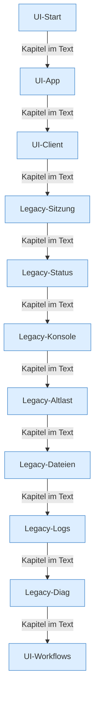

[[00 Start]] › [[Dashboard-UI]]

# Dashboard-UI



```knoten
UI-Start
  Der Einstieg der neueren [[Glossar#Bedienseite|Bedienseite]]. Er hängt die Seite in den Browser ein. Eine eigene [[Glossar#Funktion|Funktion]] hat dieser Einstieg nicht.
UI-App
  Die neuere [[Glossar#Bedienseite|Bedienseite]]. Sie übernimmt die ältere Seite, schneidet alte Bereiche heraus und hängt die neuen Abläufe ein.
UI-Client
  Der Teil der [[Glossar#Bedienseite|Bedienseite]], der Aufträge an das [[Glossar#Plugin|Plugin]] schickt und Dateien bearbeitet.
Legacy-Sitzung
  [[Glossar#Anmeldung|Anmeldung]] und Abmeldung in der älteren [[Glossar#Bedienseite|Bedienseite]].
Legacy-Status
  Die ältere [[Glossar#Bedienseite|Bedienseite]] fragt alle drei Sekunden nach, wie es dem [[Glossar#Spielserver|Spielserver]] geht.
Legacy-Konsole
  [[Glossar#Konsole|Konsole]] und Befehlszeile in der älteren [[Glossar#Bedienseite|Bedienseite]].
Legacy-Altlast
  Bereiche der älteren [[Glossar#Bedienseite|Bedienseite]], die die neuere Seite aus dem laufenden Text herausschneidet. Sie bleiben in der Datei, laufen aber nicht mit.
Legacy-Dateien
  Der Datei-Browser in der älteren [[Glossar#Bedienseite|Bedienseite]].
Legacy-Logs
  Die Protokollansicht in der älteren [[Glossar#Bedienseite|Bedienseite]].
Legacy-Diag
  Die Diagnosekarten in der älteren [[Glossar#Bedienseite|Bedienseite]].
UI-Workflows
  Die einzelnen Abläufe der [[Glossar#Bedienseite|Bedienseite]]: [[Glossar#Spieler|Spieler]], [[Glossar#Sicherungskopie|Sicherungskopie]], [[Glossar#Aufgabe|Aufgaben]], [[Glossar#Einstellungen|Einstellungen]], [[Glossar#Version|Version]] und [[Glossar#Einrichtung|Einrichtung]].
```

> [!knoten] Was die Blöcke tun
> - **UI-Start**: Der Einstieg der neueren [[Glossar#Bedienseite|Bedienseite]]. Er hängt die Seite in den Browser ein. Eine eigene [[Glossar#Funktion|Funktion]] hat dieser Einstieg nicht.
> - **UI-App**: Die neuere [[Glossar#Bedienseite|Bedienseite]]. Sie übernimmt die ältere Seite, schneidet alte Bereiche heraus und hängt die neuen Abläufe ein.
> - **UI-Client**: Der Teil der [[Glossar#Bedienseite|Bedienseite]], der Aufträge an das [[Glossar#Plugin|Plugin]] schickt und Dateien bearbeitet.
> - **Legacy-Sitzung**: [[Glossar#Anmeldung|Anmeldung]] und Abmeldung in der älteren [[Glossar#Bedienseite|Bedienseite]].
> - **Legacy-Status**: Die ältere [[Glossar#Bedienseite|Bedienseite]] fragt alle drei Sekunden nach, wie es dem [[Glossar#Spielserver|Spielserver]] geht.
> - **Legacy-Konsole**: [[Glossar#Konsole|Konsole]] und Befehlszeile in der älteren [[Glossar#Bedienseite|Bedienseite]].
> - **Legacy-Altlast**: Bereiche der älteren [[Glossar#Bedienseite|Bedienseite]], die die neuere Seite aus dem laufenden Text herausschneidet. Sie bleiben in der Datei, laufen aber nicht mit.
> - **Legacy-Dateien**: Der Datei-Browser in der älteren [[Glossar#Bedienseite|Bedienseite]].
> - **Legacy-Logs**: Die Protokollansicht in der älteren [[Glossar#Bedienseite|Bedienseite]].
> - **Legacy-Diag**: Die Diagnosekarten in der älteren [[Glossar#Bedienseite|Bedienseite]].
> - **UI-Workflows**: Die einzelnen Abläufe der [[Glossar#Bedienseite|Bedienseite]]: [[Glossar#Spieler|Spieler]], [[Glossar#Sicherungskopie|Sicherungskopie]], [[Glossar#Aufgabe|Aufgaben]], [[Glossar#Einstellungen|Einstellungen]], [[Glossar#Version|Version]] und [[Glossar#Einrichtung|Einrichtung]].

- Die [[Glossar#Bedienseite|Bedienseite]], die man im Browser sieht. Dieselbe Seite ist zweimal gebaut, einmal älter und einmal neuer. Das nennt man [[Glossar#Doppelt gebaut|Doppelt gebaut]].
- Auffällig: derselbe Teil ist zweimal vorhanden. Das nennt man [[Glossar#Doppelt gebaut|Doppelt gebaut]].
