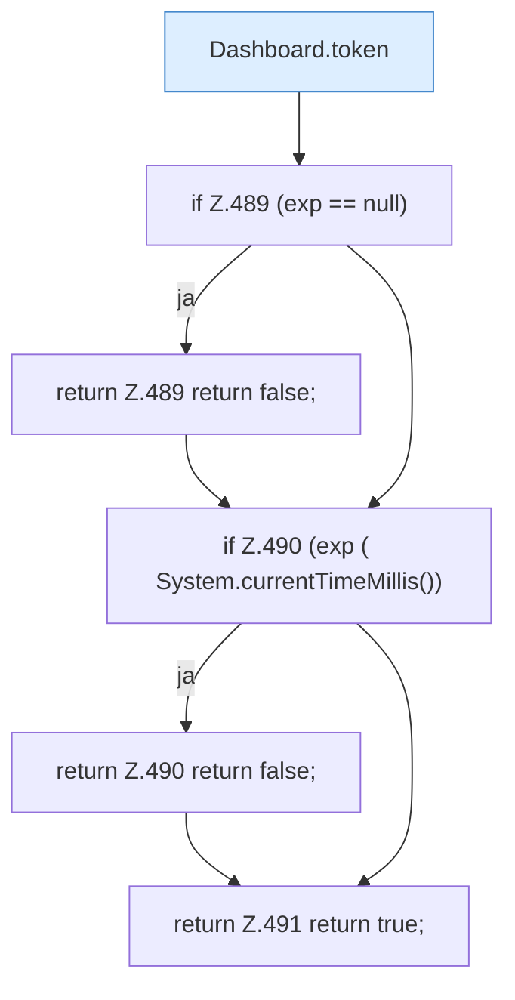

[[00 Start]] › [[Dashboard-HTTP]] › [[HTTP-Auth]] › [[Dashboard.authed]]

# Dashboard.authed

`Dashboard.authed(HttpExchange ex)` [src/main/java/de/aichele/childlauncher/Dashboard.java:486–492](https://github.com/Sciddie/minecraft-serverhoster-plugin/blob/95b02b953b0b4c23673e900e021a7c3c844aa37d/src/main/java/de/aichele/childlauncher/Dashboard.java#L486-L492)

- `authed` in `src/main/java/de/aichele/childlauncher/Dashboard.java`
