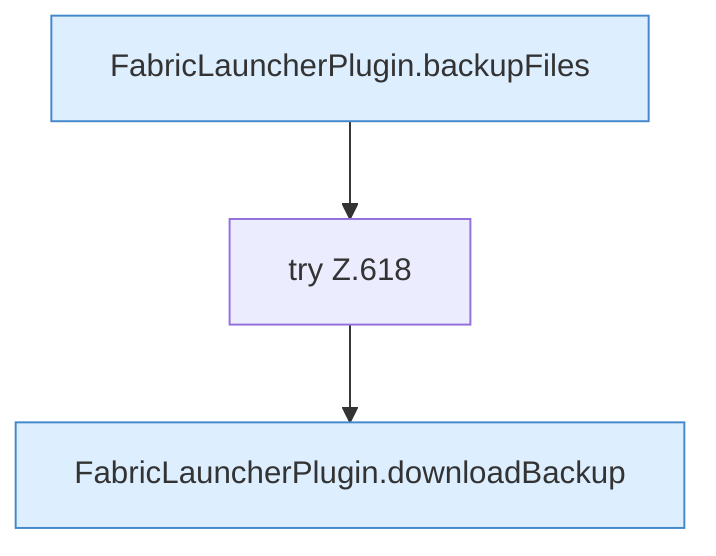

[[00 Start]] › [[Dashboard-HTTP]] › [[API-Backup]] › [[Dashboard.backupDownload]]

# Dashboard.backupDownload

`Dashboard.backupDownload(HttpExchange ex, String sid, String name)` [src/main/java/de/aichele/childlauncher/Dashboard.java:611–619](https://github.com/Sciddie/minecraft-serverhoster-plugin/blob/95b02b953b0b4c23673e900e021a7c3c844aa37d/src/main/java/de/aichele/childlauncher/Dashboard.java#L611-L619)

- `backupDownload` in `src/main/java/de/aichele/childlauncher/Dashboard.java`
- Befund: Logikrisiko, sicher. Dashboard.java nimmt die Fokus-ID, Query server wird ignoriert
