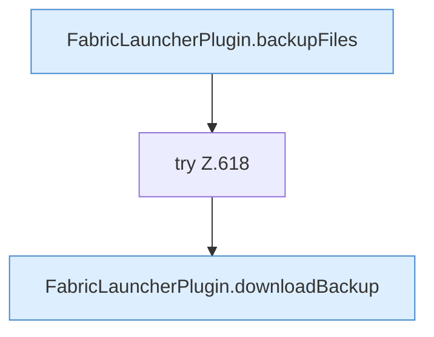

[[00 Start]] › [[Dashboard-HTTP]] › [[API-Backup]] › [[Dashboard.backupDownload]]

# Dashboard.backupDownload

`Dashboard.backupDownload(HttpExchange ex, String sid, String name)` [src/main/java/de/aichele/childlauncher/Dashboard.java:611–619](https://github.com/Sciddie/minecraft-serverhoster-plugin/blob/95b02b953b0b4c23673e900e021a7c3c844aa37d/src/main/java/de/aichele/childlauncher/Dashboard.java#L611-L619)



```knoten
FabricLauncherPlugin.backupFiles
  Das [[Glossar#Plugin|Plugin]] sichert die Dateien. Im [[Glossar#Quelltext|Quelltext]] heißt das `backupFiles`.
try Z.618
  Das Programm versucht diesen Schritt. Geht er schief, führt der andere Weg weiter. Das steht in [[Glossar#Zeile|Zeile]] 618.
FabricLauncherPlugin.downloadBackup
  Das [[Glossar#Plugin|Plugin]] holt die [[Glossar#Sicherungskopie|Sicherungskopie]]. Im [[Glossar#Quelltext|Quelltext]] heißt das `downloadBackup`.
```

> [!knoten]- Was die Blöcke tun
> - **FabricLauncherPlugin.backupFiles**: Das [[Glossar#Plugin|Plugin]] sichert die Dateien. Im [[Glossar#Quelltext|Quelltext]] heißt das `backupFiles`.
> - **try Z.618**: Das Programm versucht diesen Schritt. Geht er schief, führt der andere Weg weiter. Das steht in [[Glossar#Zeile|Zeile]] 618.
> - **FabricLauncherPlugin.downloadBackup**: Das [[Glossar#Plugin|Plugin]] holt die [[Glossar#Sicherungskopie|Sicherungskopie]]. Im [[Glossar#Quelltext|Quelltext]] heißt das `downloadBackup`.

- Die [[Glossar#Web-Schnittstelle|Web-Schnittstelle]] sichert das Herunterladen.
- Auffällig: das kann sich anders verhalten, als man erwartet. Das nennt man [[Glossar#Unerwartetes Verhalten|Unerwartetes Verhalten]].
