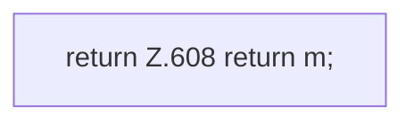

[[00 Start]] › [[Dashboard-HTTP]] › [[API-Backup]] › [[Dashboard.backupJson]]

# Dashboard.backupJson

`Dashboard.backupJson(BackupBridge.Entry e)` [src/main/java/de/aichele/childlauncher/Dashboard.java:605–609](https://github.com/Sciddie/minecraft-serverhoster-plugin/blob/95b02b953b0b4c23673e900e021a7c3c844aa37d/src/main/java/de/aichele/childlauncher/Dashboard.java#L605-L609)



```knoten
return Z.608 return m;
  Hier endet die [[Glossar#Funktion|Funktion]] und liefert ein Ergebnis zurück. Das steht in [[Glossar#Zeile|Zeile]] 608.
```

> [!knoten]- Was die Blöcke tun
> - **return Z.608 return m;**: Hier endet die [[Glossar#Funktion|Funktion]] und liefert ein Ergebnis zurück. Das steht in [[Glossar#Zeile|Zeile]] 608.

- Die [[Glossar#Web-Schnittstelle|Web-Schnittstelle]] sichert die Antwort.
