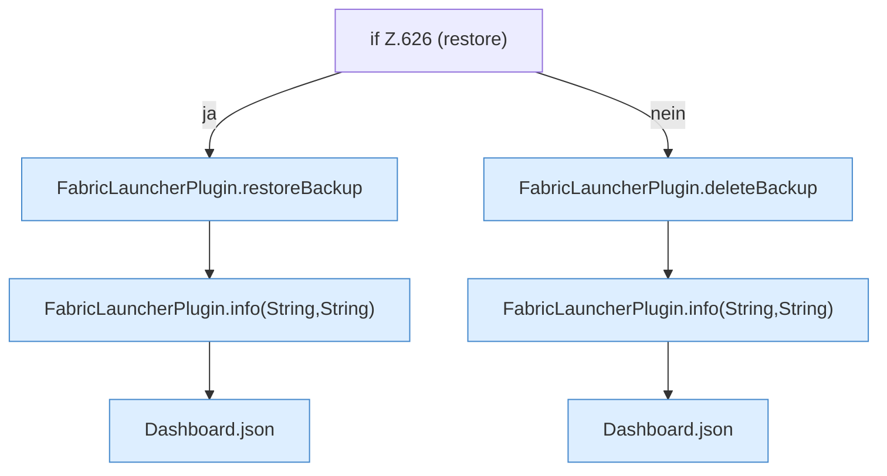

[[00 Start]] › [[Dashboard-HTTP]] › [[API-Backup]] › [[Dashboard.backupMutate]] › [[Dashboard.backupMutate.Z626]]

# Dashboard.backupMutate.Z626



```knoten
if Z.626 (restore)
  Zeile 626: prüft `(restore)`.
FabricLauncherPlugin.restoreBackup
  Stellt wieder her `restoreBackup`. Ruft `slot`, `running`, `remoteBackupSelected`.
FabricLauncherPlugin.info(String,String)
  Schreibt eine Infozeile `info`. Ruft `slot`.
Dashboard.json
  Antwortet mit JSON `json`. Ruft `sendBytes`.
FabricLauncherPlugin.deleteBackup
  Löscht `deleteBackup`. Ruft `remoteBackupSelected`, `backupCredentials`, `delete`.
```

- Fortsetzung von `Dashboard.backupMutate`, Quellreihenfolge.
