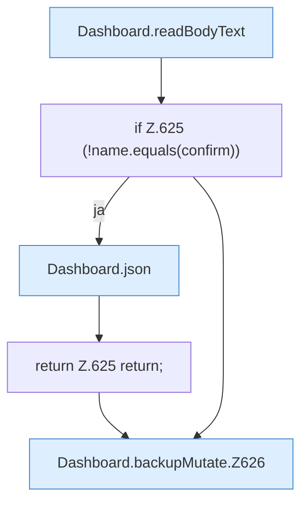

[[00 Start]] › [[Dashboard-HTTP]] › [[API-Backup]] › [[Dashboard.backupMutate]]

# Dashboard.backupMutate

`Dashboard.backupMutate(HttpExchange ex, String sid, boolean restore)` [src/main/java/de/aichele/childlauncher/Dashboard.java:621–635](https://github.com/Sciddie/minecraft-serverhoster-plugin/blob/95b02b953b0b4c23673e900e021a7c3c844aa37d/src/main/java/de/aichele/childlauncher/Dashboard.java#L621-L635)



```knoten
Dashboard.readBodyText
  Liest `readBodyText`.
if Z.625 (!name.equals(confirm))
  Zeile 625: prüft `(!name.equals(confirm))`.
Dashboard.json
  Antwortet mit JSON `json`. Ruft `sendBytes`.
return Z.625 return;
  Zeile 625: Rückgabe `return;`.
Dashboard.backupMutate.Z626
  Fortsetzung des Ablaufs ab Zeile 626.
```

- `backupMutate` in `src/main/java/de/aichele/childlauncher/Dashboard.java`
