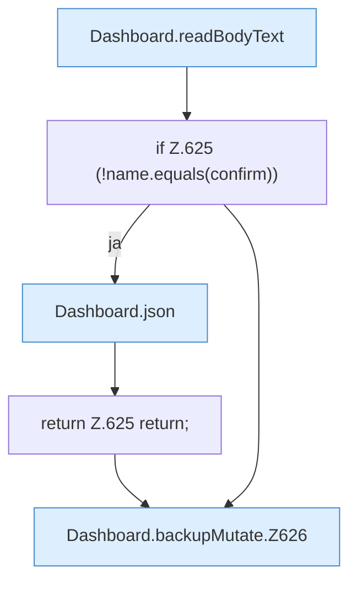

[[00 Start]] › [[Dashboard-HTTP]] › [[API-Backup]] › [[Dashboard.backupMutate]]

# Dashboard.backupMutate

`Dashboard.backupMutate(HttpExchange ex, String sid, boolean restore)` [src/main/java/de/aichele/childlauncher/Dashboard.java:621–635](https://github.com/Sciddie/minecraft-serverhoster-plugin/blob/95b02b953b0b4c23673e900e021a7c3c844aa37d/src/main/java/de/aichele/childlauncher/Dashboard.java#L621-L635)



```knoten
Dashboard.readBodyText
  Die [[Glossar#Web-Schnittstelle|Web-Schnittstelle]] liest den Text den Text. Im [[Glossar#Quelltext|Quelltext]] heißt das `readBodyText`.
if Z.625 (!name.equals(confirm))
  Hier fällt eine Entscheidung. Nur wenn sie zutrifft, geht es den Ja-Weg weiter. Das steht in [[Glossar#Zeile|Zeile]] 625.
Dashboard.json
  Die [[Glossar#Web-Schnittstelle|Web-Schnittstelle]] macht hier einen einzelnen Schritt. Eine Ebene tiefer steht er genauer. Im [[Glossar#Quelltext|Quelltext]] heißt das `json`.
return Z.625 return;
  Hier endet die [[Glossar#Funktion|Funktion]] und liefert ein Ergebnis zurück. Das steht in [[Glossar#Zeile|Zeile]] 625.
Dashboard.backupMutate.Z626
  Der Ablauf geht in [[Glossar#Zeile|Zeile]] 626 weiter. Eine Ebene tiefer steht er genauer. Im [[Glossar#Quelltext|Quelltext]] heißt das `Z626`.
```

> [!knoten]- Was die Blöcke tun
> - **Dashboard.readBodyText**: Die [[Glossar#Web-Schnittstelle|Web-Schnittstelle]] liest den Text den Text. Im [[Glossar#Quelltext|Quelltext]] heißt das `readBodyText`.
> - **if Z.625 (!name.equals(confirm))**: Hier fällt eine Entscheidung. Nur wenn sie zutrifft, geht es den Ja-Weg weiter. Das steht in [[Glossar#Zeile|Zeile]] 625.
> - **Dashboard.json**: Die [[Glossar#Web-Schnittstelle|Web-Schnittstelle]] macht hier einen einzelnen Schritt. Eine Ebene tiefer steht er genauer. Im [[Glossar#Quelltext|Quelltext]] heißt das `json`.
> - **return Z.625 return;**: Hier endet die [[Glossar#Funktion|Funktion]] und liefert ein Ergebnis zurück. Das steht in [[Glossar#Zeile|Zeile]] 625.
> - **Dashboard.backupMutate.Z626**: Der Ablauf geht in [[Glossar#Zeile|Zeile]] 626 weiter. Eine Ebene tiefer steht er genauer. Im [[Glossar#Quelltext|Quelltext]] heißt das `Z626`.

- Ändert eine vorhandene [[Glossar#Sicherungskopie|Sicherungskopie]], zum Beispiel löschen oder zurückholen.
