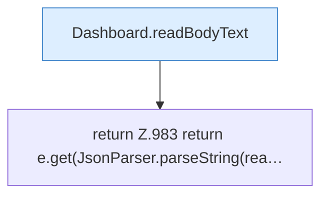

[[00 Start]] › [[Dashboard-HTTP]] › [[API-Antworten]] › [[Dashboard.body]]

# Dashboard.body

`Dashboard.body(HttpExchange ex, Extract e)` [src/main/java/de/aichele/childlauncher/Dashboard.java:983–983](https://github.com/Sciddie/minecraft-serverhoster-plugin/blob/95b02b953b0b4c23673e900e021a7c3c844aa37d/src/main/java/de/aichele/childlauncher/Dashboard.java#L983-L983)



```knoten
Dashboard.readBodyText
  Die [[Glossar#Web-Schnittstelle|Web-Schnittstelle]] liest den Text den Text. Im [[Glossar#Quelltext|Quelltext]] heißt das `readBodyText`.
return Z.983 return e.get(JsonParser.parseString(rea…
  Hier endet die [[Glossar#Funktion|Funktion]] und liefert ein Ergebnis zurück. Das steht in [[Glossar#Zeile|Zeile]] 983.
```

> [!knoten]- Was die Blöcke tun
> - **Dashboard.readBodyText**: Die [[Glossar#Web-Schnittstelle|Web-Schnittstelle]] liest den Text den Text. Im [[Glossar#Quelltext|Quelltext]] heißt das `readBodyText`.
> - **return Z.983 return e.get(JsonParser.parseString(rea…**: Hier endet die [[Glossar#Funktion|Funktion]] und liefert ein Ergebnis zurück. Das steht in [[Glossar#Zeile|Zeile]] 983.

- Die [[Glossar#Web-Schnittstelle|Web-Schnittstelle]] macht hier einen einzelnen Schritt. Eine Ebene tiefer steht er genauer.
