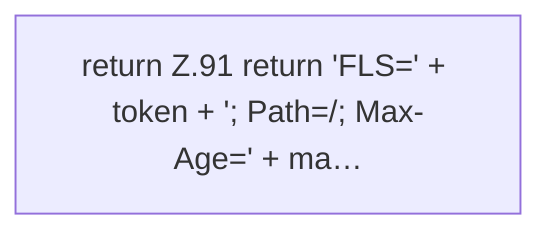

[[00 Start]] › [[Dashboard-HTTP]] › [[HTTP-Start]] › [[Dashboard.cookie]]

# Dashboard.cookie

`Dashboard.cookie(String token, long maxAge)` [src/main/java/de/aichele/childlauncher/Dashboard.java:90–92](https://github.com/Sciddie/minecraft-serverhoster-plugin/blob/95b02b953b0b4c23673e900e021a7c3c844aa37d/src/main/java/de/aichele/childlauncher/Dashboard.java#L90-L92)



```knoten
return Z.91 return 'FLS=' + token + '; Path=/; Max-Age=' + ma…
  Hier endet die [[Glossar#Funktion|Funktion]] und liefert ein Ergebnis zurück. Das steht in [[Glossar#Zeile|Zeile]] 91.
```

> [!knoten]- Was die Blöcke tun
> - **return Z.91 return 'FLS=' + token + '; Path=/; Max-Age=' + ma…**: Hier endet die [[Glossar#Funktion|Funktion]] und liefert ein Ergebnis zurück. Das steht in [[Glossar#Zeile|Zeile]] 91.

- Liest oder setzt die [[Glossar#Anmeldung|Anmeldung]], die der Browser mitschickt.
