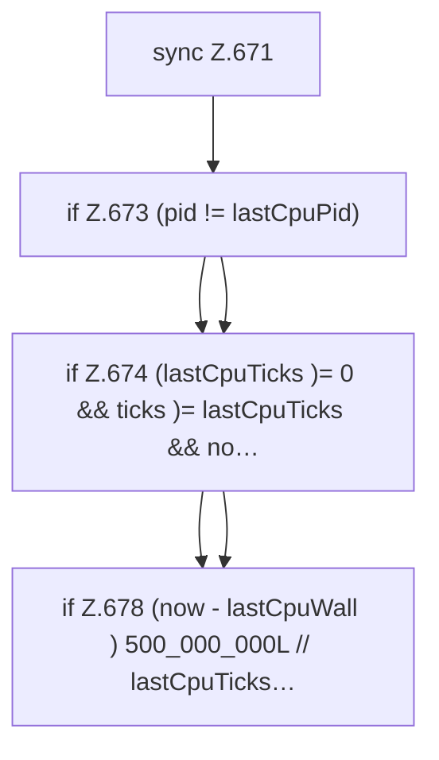

[[00 Start]] › [[Dashboard-HTTP]] › [[API-Status]] › [[Dashboard.cpu]] › [[Dashboard.cpu.Z667.Z671]]

# Dashboard.cpu.Z667.Z671



```knoten
sync Z.671
  Zeile 671: synchronisierter Block.
if Z.673 (pid != lastCpuPid)
  Zeile 673: prüft `(pid != lastCpuPid)`.
if Z.674 (lastCpuTicks )= 0 && ticks )= lastCpuTicks && no…
  Zeile 674: prüft `(lastCpuTicks )= 0 && ticks )= lastCpuTicks && no…`.
if Z.678 (now - lastCpuWall ) 500_000_000L // lastCpuTicks…
  Zeile 678: prüft `(now - lastCpuWall ) 500_000_000L // lastCpuTicks…`.
```

- Fortsetzung von `Dashboard.cpu.Z667`, Quellreihenfolge.
