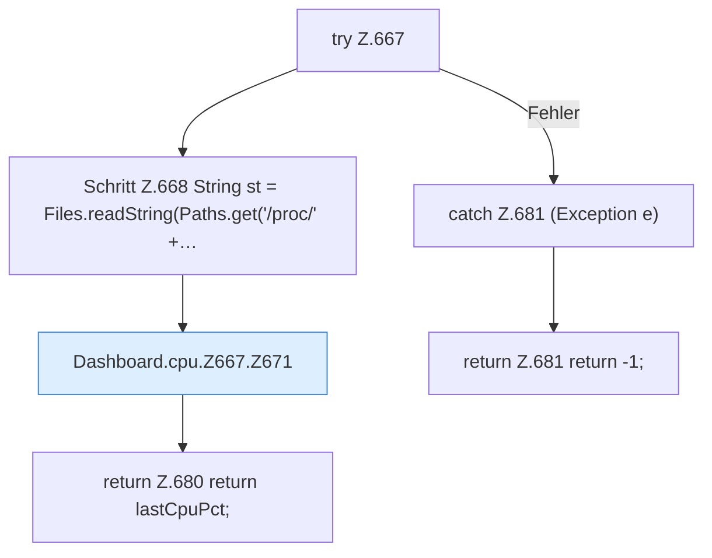

[[00 Start]] › [[Dashboard-HTTP]] › [[API-Status]] › [[Dashboard.cpu]] › [[Dashboard.cpu.Z667]]

# Dashboard.cpu.Z667



```knoten
try Z.667
  Zeile 667: Versuch. Der Fehlerpfad geht in catch.
Schritt Z.668 String st = Files.readString(Paths.get('/proc/' +…
  Zeile 668: liest Text aus einer Datei. `String st = Files.readString(Paths.get('/proc/' +…`
Dashboard.cpu.Z667.Z671
  Fortsetzung des Ablaufs ab Zeile 671.
return Z.680 return lastCpuPct;
  Zeile 680: Rückgabe `return lastCpuPct;`.
catch Z.681 (Exception e)
  Zeile 681: fängt (Exception e).
return Z.681 return -1;
  Zeile 681: Rückgabe `return -1;`.
```

- Fortsetzung von `Dashboard.cpu`, Quellreihenfolge.
