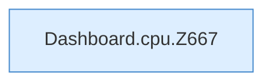

[[00 Start]] › [[Dashboard-HTTP]] › [[API-Status]] › [[Dashboard.cpu]]

# Dashboard.cpu

`Dashboard.cpu(long pid)` [src/main/java/de/aichele/childlauncher/Dashboard.java:666–682](https://github.com/Sciddie/minecraft-serverhoster-plugin/blob/95b02b953b0b4c23673e900e021a7c3c844aa37d/src/main/java/de/aichele/childlauncher/Dashboard.java#L666-L682)

- Liest `/proc/<pid>/stat` und teilt durch 100.
- Befund: Logikrisiko, prüfen. Dashboard.java:676 Kommentar CLK_TCK=100, Division durch 100
