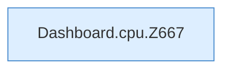

[[00 Start]] › [[Dashboard-HTTP]] › [[API-Status]] › [[Dashboard.cpu]]

# Dashboard.cpu

`Dashboard.cpu(long pid)` [src/main/java/de/aichele/childlauncher/Dashboard.java:666–682](https://github.com/Sciddie/minecraft-serverhoster-plugin/blob/95b02b953b0b4c23673e900e021a7c3c844aa37d/src/main/java/de/aichele/childlauncher/Dashboard.java#L666-L682)



```knoten
Dashboard.cpu.Z667
  Der Ablauf geht in [[Glossar#Zeile|Zeile]] 667 weiter. Eine Ebene tiefer steht er genauer. Im [[Glossar#Quelltext|Quelltext]] heißt das `Z667`.
```

> [!knoten]- Was die Blöcke tun
> - **Dashboard.cpu.Z667**: Der Ablauf geht in [[Glossar#Zeile|Zeile]] 667 weiter. Eine Ebene tiefer steht er genauer. Im [[Glossar#Quelltext|Quelltext]] heißt das `Z667`.

- Rechnet aus, wie stark der [[Glossar#Prozess|Prozess]] den Rechner beschäftigt. Die Rechnung nimmt an, dass die Uhr des Systems hundert Schritte pro Sekunde hat.
- Auffällig: das kann sich anders verhalten, als man erwartet. Das nennt man [[Glossar#Unerwartetes Verhalten|Unerwartetes Verhalten]].
