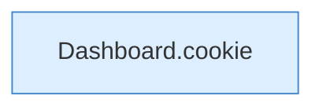

[[00 Start]] › [[Dashboard-HTTP]] › [[HTTP-Auth]] › [[Dashboard.createSession]]

# Dashboard.createSession

`Dashboard.createSession(HttpExchange ex, long now)` [src/main/java/de/aichele/childlauncher/Dashboard.java:286–292](https://github.com/Sciddie/minecraft-serverhoster-plugin/blob/95b02b953b0b4c23673e900e021a7c3c844aa37d/src/main/java/de/aichele/childlauncher/Dashboard.java#L286-L292)

- `createSession` in `src/main/java/de/aichele/childlauncher/Dashboard.java`
