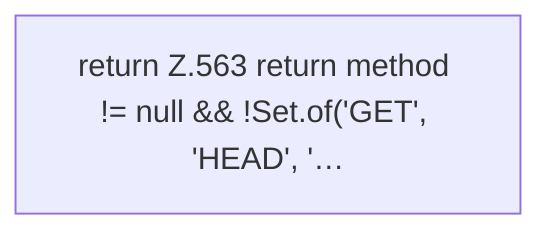

[[00 Start]] › [[Dashboard-HTTP]] › [[HTTP-Auth]] › [[Dashboard.csrfRejected]]

# Dashboard.csrfRejected

`Dashboard.csrfRejected(String method, String header)` [src/main/java/de/aichele/childlauncher/Dashboard.java:562–564](https://github.com/Sciddie/minecraft-serverhoster-plugin/blob/95b02b953b0b4c23673e900e021a7c3c844aa37d/src/main/java/de/aichele/childlauncher/Dashboard.java#L562-L564)

- `csrfRejected` in `src/main/java/de/aichele/childlauncher/Dashboard.java`
