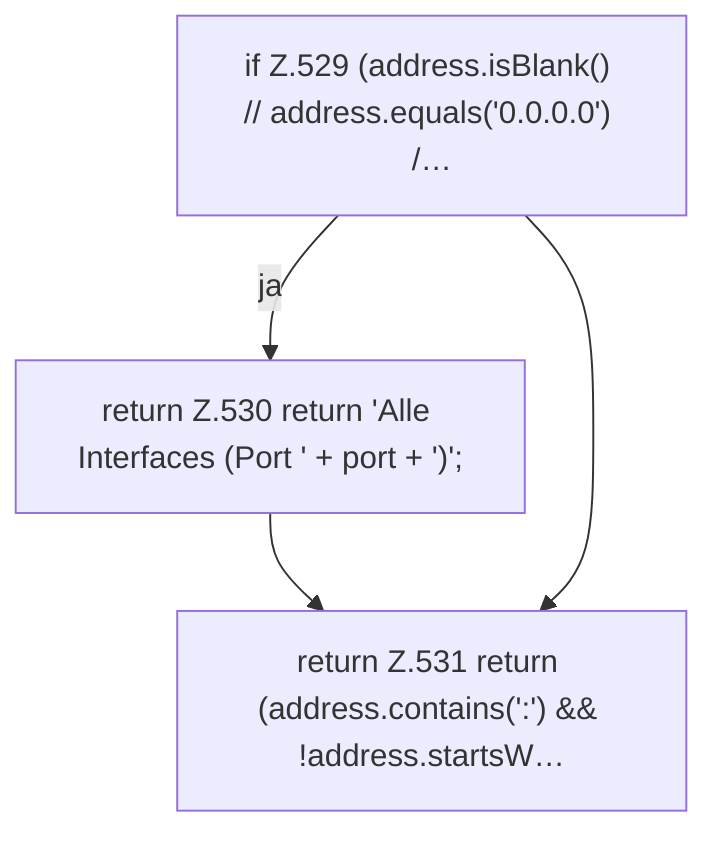

[[00 Start]] › [[Dashboard-HTTP]] › [[API-Status]] › [[Dashboard.formatBindAddress]]

# Dashboard.formatBindAddress

`Dashboard.formatBindAddress(String address, int port)` [src/main/java/de/aichele/childlauncher/Dashboard.java:528–532](https://github.com/Sciddie/minecraft-serverhoster-plugin/blob/95b02b953b0b4c23673e900e021a7c3c844aa37d/src/main/java/de/aichele/childlauncher/Dashboard.java#L528-L532)

- `formatBindAddress` in `src/main/java/de/aichele/childlauncher/Dashboard.java`
